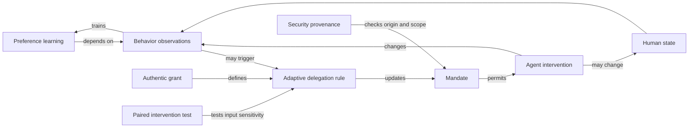

# Cross-field conceptual map

Version 0.1.1. Evidence cutoff 2026-10-04. This is a scoped research map, not a
systematic review with exhaustive recall. Three parallel field notes supply
approximately 24,000 words of proposition-level ancestry, limitations, and
candidate search. Their additional 120 seeds remain local to those notes; the
canonical population starts with 154 individually authored candidates.

## What is already known

| Object | Established framework | What it explains | Boundary for this project |
|---|---|---|---|
| Uncertain goals | IRL, CIRL, assistance games [S03, S22] | Learning and assistance interact | Reward parameters often fixed within a model |
| Corrective intervention | Corrigibility, off-switch games [S04] | Incentives to permit correction | Correction authority and social capacity can be contested |
| Behavioral feedback | Performative prediction [S05] | Deployment changes evaluation data | Prediction risk does not itself specify legitimate authority |
| Preference change | Preference construction, endogenous tastes, safe shifts [S06, S07] | User state can be changed by recommendation | Identifying a normatively acceptable baseline remains hard |
| Human competence | Automation ironies, out-of-loop performance [S01, S02] | Less practice can impair exception handling | Long-run general claims about AI need new evidence |
| Motivation | Self-determination theory [S12] | Autonomy, competence, relatedness matter | These do not collapse into one legal or engineering score |
| Human agency | Procedural and relational autonomy; meaningful human control [S18] | Endorsement, options, reasons, responsibility | A broad agency-preservation manifesto is derivative |
| Distributed cognition | Extended mind, institutional memory [S13] | External resources can be functionally integrated | Functional dependence does not settle metaphysical identity |
| Authority | Agency law, capability security, FLAC [S10] | Scope, provenance, attenuation, controlled release | Authentic rule application can still have endogenous inputs |
| Agent memory | Temporal memory benchmarks, EAL [S08] | Summary errors can create spurious permissions | Accurate records do not establish a good adaptive rule |
| Downstream effects | Closure-bound approval [S09] | Approved invocation can hide transitive effects | Different from scope-rule feedback through human behavior |
| Collective institutions | Ostrom, mechanism design [S21, S24] | Incentives and local rules govern coordination | No individual account can settle communal authority alone |
| Risk governance | NIST RMF, AI Act [S15–S17] | Lifecycle risk and actor-specific duties | No claim that existing law ignores all feedback risks |
| Artificial moral standing | AI welfare under uncertainty [S14] | Assessment and preparation without categorical conclusions | Separate patienthood evidence from safety authorization |

## The research graph

Most edges are known. The research candidate targets the last test edge: compare
the authority trajectories created by permissible intervention policies under an
unchanged authentic adaptive rule. A graph that joins known concepts is not itself
proof of novelty.

## Search limits

Recent records were checked against primary pages. Several 2026 preprints have
only abstract-level verification in the central register and require full-text
review before submission. Standards behind paywalls were checked only through
official scope records. No certification or legal compliance is claimed.

The field notes deliberately expose cultural and religious variation. They are
not population samples and cannot license a uniform policy for a nation or faith.
The current framework must support plural principals, legitimate representatives,
and locally defined ratification procedures.

## Discovery decision

Twelve seeds advance to mutation. General autonomy, dignity, trust, dependency,
consent, human oversight, skill preservation, and reversible delegation are
inherited foundations. They cannot become the advertised discovery. The remaining
proposal needs an operational test that differs from its closest precedents.
